  

  <a href="https://heyatom.dev"><b>heyatom.dev</b></a> ·
  <a href="https://www.linkedin.com/in/atombolato">LinkedIn</a> ·
  <a href="mailto:hey@heyatom.dev">hey@heyatom.dev</a>

---

By day I build **Meview** at [Medas Solutions](https://medas-solutions.it/): the patient portal dozens of Italian hospitals and labs use to publish medical reports and collect exam consents. Java and Vue/Nuxt, GDPR-bound health data, SPID/CIE login, digital signature, HL7.

By night I run my own small platform: a set of NestJS services that handle auth, mail, content, media and events, so every new side project starts with the boring parts already done.

## Projects

| | Project | What it is | Stack |
|---|---|---|---|
| 🎮 | **[DBD Builds](https://dbd-builds.it)** | Dead by Daylight build sharing and translated wiki. 500+ builds, ~1k visitors a month | NestJS · Nuxt · Vuetify |
| 🗂️ | **[FileHarbor](https://github.com/andreacw5/fileharbor)** | Multi-tenant image and media CDN with albums and avatars | NestJS · Prisma |
| 📝 | **[Articuno](https://github.com/heyatomdev/articuno)** | Headless CMS with translations, moderation and webhooks | NestJS · Prisma |
| 📅 | **[Gatherly](https://github.com/heyatomdev/gatherly)** | Event API with i18n, recurrence and signed webhooks | NestJS · Prisma |
| 🔗 | **[Ziplink](https://github.com/andreacw5/ziplink)** | URL shortener with click stats and custom codes | NestJS · Prisma |

## Stack

## Off the keyboard

- 🚨 Civil protection volunteer since 2014: team leader in Settimo Milanese for twelve years, now in Milan.
- 🕹️ Technical manager and board member at [Element Gaming](https://element-gaming.eu) since 2019.
