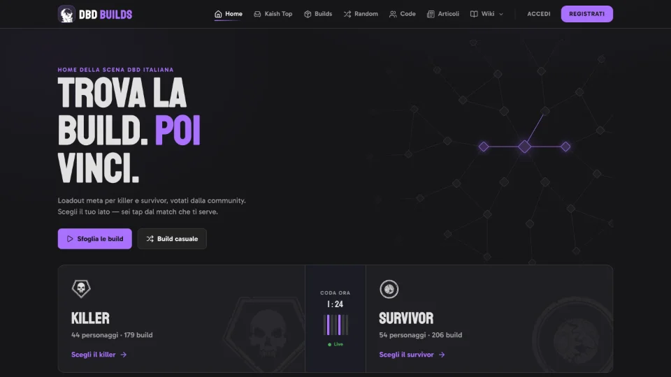
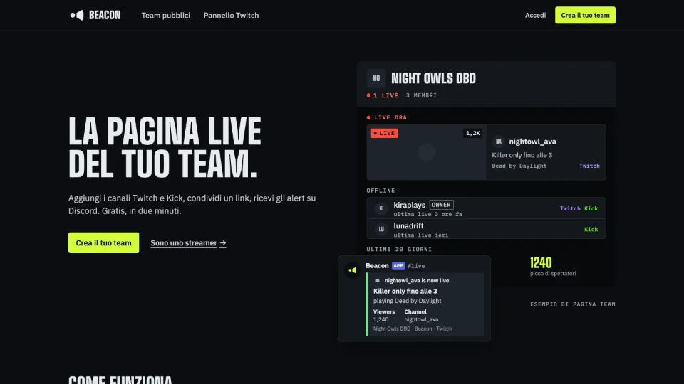
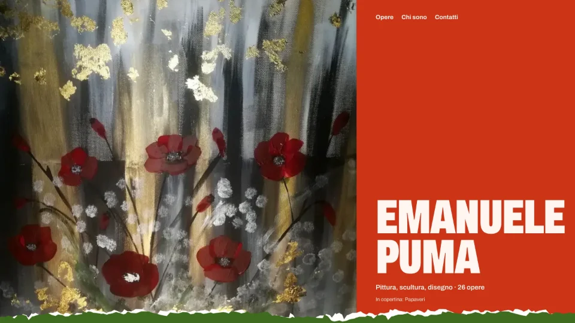
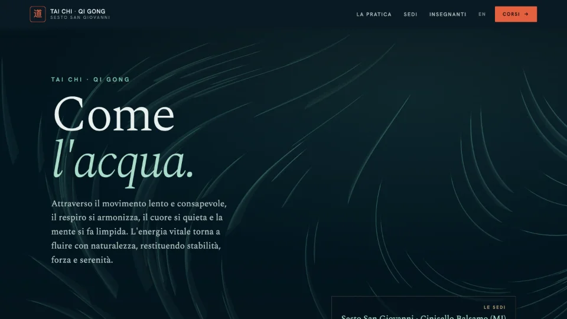

  

  <a href="https://heyatom.dev"><b>heyatom.dev</b></a> ·
  <a href="https://www.linkedin.com/in/atombolato">LinkedIn</a> ·
  <a href="mailto:hey@heyatom.dev">hey@heyatom.dev</a>

---

By day I build **Meview** at [Medas Solutions](https://medas-solutions.it/): the patient portal dozens of Italian hospitals and labs use to publish medical reports and collect exam consents. Java and Vue/Nuxt, GDPR-bound health data, SPID/CIE login, digital signature, HL7.

By night I run my own small platform: a set of NestJS services that handle auth, mail, content, media and events, so every new side project starts with the boring parts already done.

## Selected work

<table>
  <tr>
    <td width="50%" valign="top">
      
      <h3><a href="https://dbd-builds.it">DBD Builds</a></h3>
      
Build creator and fully translated wiki for Dead by Daylight, made for streamer Kaish79's community. 500+ builds shared, ~1k visitors a month.

      
<code>Nuxt</code> <code>Vuetify</code> <code>NestJS</code> <code>Prisma</code> <code>PostgreSQL</code>

    </td>
    <td width="50%" valign="top">
      
      <h3><a href="https://beacon.heyatom.dev/it">Beacon</a></h3>
      
Live page for a team of streamers on Twitch and Kick: who's on air right now, stream stats, Discord alerts when someone goes live.

      
<code>Nuxt</code> <code>NestJS</code> <code>Prisma</code> <code>Twitch API</code> <code>Kick API</code>

    </td>
  </tr>
  <tr>
    <td width="50%" valign="top">
      
      <h3><a href="https://studioartepuma.it/">Studio Arte Puma</a></h3>
      
Showcase for painter and sculptor Emanuele Puma, laid out as a journey through his work and built phone-first for visitors coming from Instagram.

      
<code>Nuxt</code> <code>GSAP</code> <code>FileHarbor</code> <code>Docker</code>

    </td>
    <td width="50%" valign="top">
      
      <h3><a href="https://taichisesto.it/">Tai Chi Sesto</a></h3>
      
Bilingual site for Tai Chi and Qi Gong classes around Milan: venues, schedules, teachers, and a direct line to the instructor.

      
<code>Nuxt</code> <code>Vuetify</code> <code>TypeScript</code>

    </td>
  </tr>
</table>

## Open source

- **[FileHarbor](https://github.com/andreacw5/fileharbor)**: uploads, optimizes and serves images and video, with automatic WebP, on-the-fly resizing and public or private albums.
- **[Articuno](https://github.com/heyatomdev/articuno)**: multi-tenant CMS with translations, auto-moderated comments and exactly-once webhooks.
- **[Gatherly](https://github.com/heyatomdev/gatherly)**: event API with RFC 5545 recurrence, categories, tags and guest participants.
- **[Ziplink](https://github.com/andreacw5/ziplink)**: URL shortener with custom codes, click counts and a documented API.
- **[AlertConnector](https://github.com/prociv-sm/management-api)**: Italian Civil Protection emergency alerts, normalized behind a REST API.
- **[nuxt-template](https://github.com/andreacw5/nuxt-template)**: my Nuxt 4 starter with Vuetify, TypeScript, Pinia, i18n and SEO ready.

Everything else, back to 2016, is on **[heyatom.dev/works](https://heyatom.dev/en/works)**.

## Stack

## Off the keyboard

- 🚨 Civil protection volunteer since 2014: team leader in Settimo Milanese for twelve years, now in Milan.
- 🕹️ Technical manager and board member at [Element Gaming](https://element-gaming.eu) since 2019.
